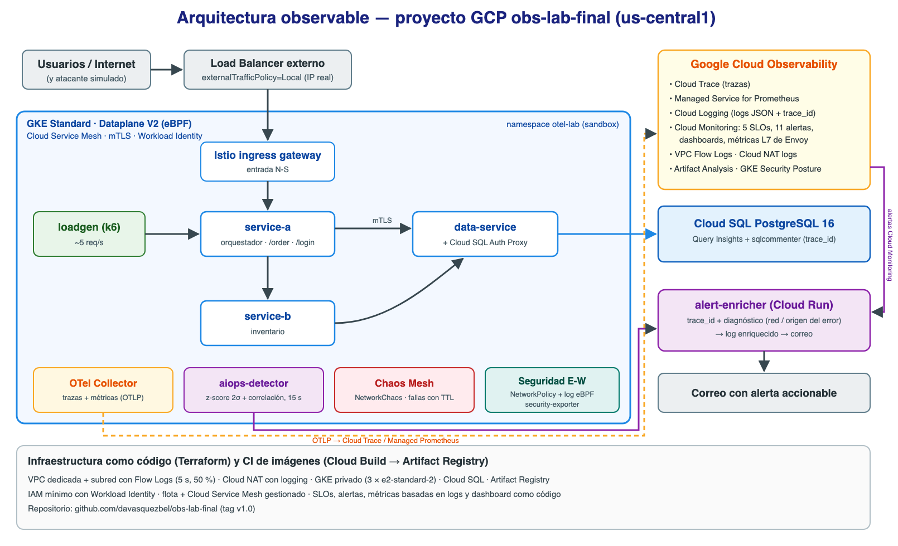

# obs-lab-final — Sistema observable de nivel producción en GCP

Laboratorio integrador de **Observabilidad en Ambientes Productivos** (Maestría en Arquitectura de Software).
Integra los tres pilares con OpenTelemetry, AIOps, observabilidad de red y seguridad, SRE (SLO /
error budget) y Chaos Engineering sobre Google Cloud, todo desplegado con Terraform.



> Basado en los repositorios guía [`mafeopa/oTelLabs`](https://github.com/mafeopa/oTelLabs) y
> [`mafeopa/chaos_k8s`](https://github.com/mafeopa/chaos_k8s). **Alcance: solo GCP** (decisión del
> estudiante; el reporte incluye la equivalencia con AWS).

## Arquitectura

```
                 Internet ──► Load Balancer (externalTrafficPolicy=Local) ──► Istio ingress gateway
                                                                                    │ mTLS
 ┌──────────────────────── GKE Standard · Dataplane V2 (eBPF) · Cloud Service Mesh ─▼──────────────┐
 │  loadgen (k6) ─► service-a ──► service-b ──► data-service ──(Cloud SQL Auth Proxy)──► Cloud SQL │
 │                     └────────────────────────────►┘                            PostgreSQL 16     │
 │  OTel SDK (trazas + métricas) ─► OTel Collector ─► Cloud Trace · Managed Service for Prometheus  │
 │  Logs JSON con trace_id ─────────────────────────► Cloud Logging                                 │
 │  aiops-detector (z-score 2σ + correlación, cada 15 s)   security-exporter (CVEs + postura)       │
 │  Chaos Mesh (NetworkChaos)   NetworkPolicy default-deny + NetworkLogging (eBPF)                  │
 └──────────────────────────────────────────────────────────────────────────────────────────────────┘
 VPC Flow Logs · Cloud NAT logs · Artifact Analysis · GKE Security Posture
 Cloud Monitoring: 5 SLOs · 11 políticas de alerta · dashboard "Golden Signals de Seguridad"
 alert-enricher (Cloud Run): agrega trace_id + diagnóstico a cada alerta → correo
```

## Resultados principales

| Módulo | Resultado |
|---|---|
| **A** — Arquitectura observable | 3 microservicios + Cloud SQL con OTel (3 pilares correlacionados por `trace_id`, DB Semantic Conventions, sqlcommenter → Query Insights); Cloud Service Mesh con mTLS STRICT (100 % del tráfico E-W) y métricas L7. |
| **B** — AIOps | Baseline dinámico (μ + 2σ) y regla de correlación `error_rate > baseline + 2σ AND p99 > SLO`. En una prueba de 33 min: **−87 % alertas ruidosas** (15 → 2) y **0 páginas falsas** frente a umbrales estáticos; alertas enriquecidas con `trace_id` y diagnóstico. |
| **C** — Red y seguridad | VPC Flow Logs (E-W/N-S con metadatos de pod e IP/ciudad del cliente), microsegmentación con logging eBPF (movimiento lateral detectado en **56 s**), fuerza bruta (μ + 3σ), CVEs y postura publicados como métricas, dashboard de Golden Signals de Seguridad. |
| **D** — Chaos Engineering | +200 ms en service-b y 10 % de errores en data-service: **MTTD 69 s y 77 s** (objetivo < 120 s); SLO de latencia y de disponibilidad degradados; consumo de **29.7 %** y **11.9 %** del error budget diario. |
| **E** — Madurez | Autoevaluación 8 dominios: **3.0 / 5**; roadmap a 3 meses → 3.9. Ver [docs/MADUREZ_Y_ROADMAP.md](docs/MADUREZ_Y_ROADMAP.md). |

## Estructura

| Ruta | Contenido |
|---|---|
| `infra/terraform/` | IaC completa: red + Flow Logs + NAT, GKE, Cloud SQL, Artifact Registry, IAM/Workload Identity, Cloud Service Mesh, SLOs, alertas, webhook, métricas de seguridad y dashboard |
| `services/` | `service-a`, `service-b`, `data-service` (FastAPI + OTel), `common/` (telemetría e inyección de fallas), `alert-enricher`, `aiops-detector`, `security-exporter` |
| `k8s/` | Manifiestos: namespace, Collector, servicios, loadgen, mesh, gateway, detector, NetworkPolicy, CronJob de seguridad |
| `chaos/` | Experimentos de caos y valores de Helm de Chaos Mesh |
| `scripts/` | Despliegue, verificación, pruebas de ruido/backtest, simulación de ataques, caos, demo |
| `docs/` | Madurez y roadmap; material de referencia de los repositorios guía |

## Puesta en marcha

```bash
cd infra/terraform && terraform init && terraform apply      # ~20 min (+ hasta 60 min el mesh gestionado)
cd ../../services && gcloud builds submit . --config cloudbuild.yaml --substitutions=_TAG=1.0.6
cd .. && scripts/deploy.sh            # namespace, secretos, Collector, servicios, loadgen
scripts/deploy-mesh.sh                # sidecars, gateway, mTLS, políticas L7
helm upgrade --install chaos-mesh chaos-mesh/chaos-mesh -n chaos-mesh --create-namespace \
  --version 2.8.5 -f chaos/chaos-mesh-values.yaml
scripts/deploy-aiops.sh               # detector AIOps en tiempo real
kubectl apply -f k8s/60-network-security.yaml -f k8s/70-security-exporter.yaml
```

## Scripts de verificación y experimentos

| Script | Qué hace |
|---|---|
| `scripts/verify-pillars.sh [trace_id]` | Traza + métricas + logs de una misma petición |
| `scripts/verify-mesh.sh` | Estado del mesh, sidecars, mTLS y métricas L7 |
| `scripts/aiops-noise-test.sh` + `noise_report.py` + `backtest_alerts.py` | Prueba de ruido y comparación cuantitativa de motores de alerta |
| `scripts/security-sim.sh [bruteforce\|scan]` | Fuerza bruta N-S y escaneo lateral E-W controlados |
| `scripts/chaos-run.sh` + `chaos_report.py` | Experimentos de caos y análisis de MTTD/SLO/error budget |
| `scripts/demo.sh` | Demostración en vivo guiada |

## Costos

Proyecto de free trial. Pausar: `terraform apply -var node_count=0`. Destruir: `terraform destroy`.
